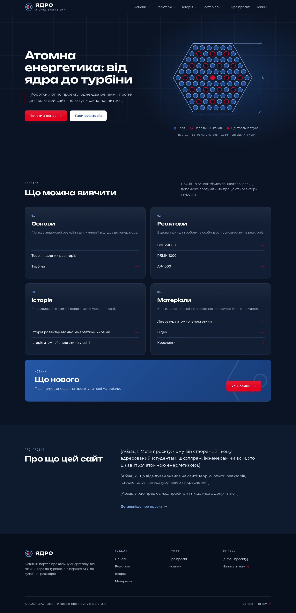
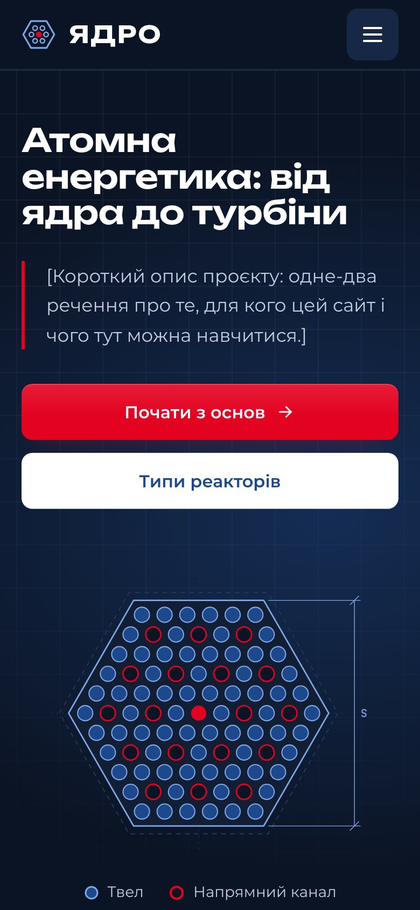
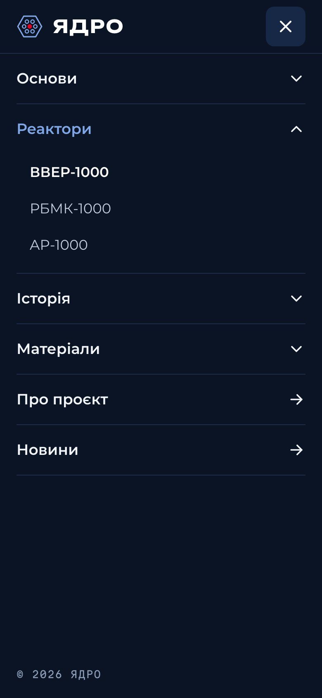
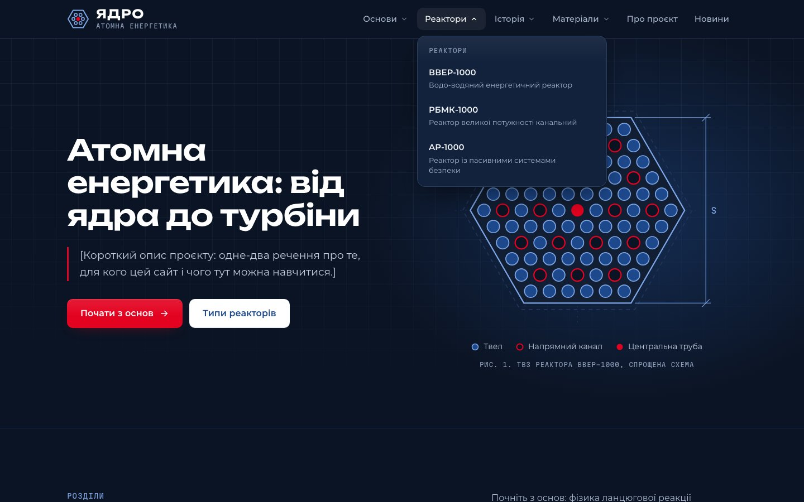

# ☢️ Core Web

[](https://github.com/Core-Ukraine/core-web/actions/workflows/ci.yml)
[](https://github.com/Core-Ukraine/core-web/actions/workflows/codeql.yml)

The website of **ЯДРО**, an educational portal about nuclear energy in Ukrainian: how a chain reaction works, how the VVER-1000, RBMK-1000 and AP-1000 reactors are built, how the industry grew in Ukraine and the world, and where to find books, videos and drawings. The dark design follows the ES Group colours and the look of an engineering drawing. Built with Next.js 16, React 19 and TypeScript 7, every page prerendered, accessible and fast.

> [!NOTE]
> The texts in square brackets, such as `[Короткий опис проєкту]`, are placeholders from the design. [Content](./docs/content.md) explains where each of them lives.



## ✨ Highlights

- 🏠 **Home page from the design**: the first screen on a blueprint grid with a drawing of a VVER-1000 fuel assembly that grows ring by ring, the four sections to learn, a news band and what the site is about
- 🧭 **Main menu**: a sticky bar of plain words: four sections open a list of topics with short descriptions, two pages open right away; the current one is brighter, the open one sits on a soft pill
- 📱 **Phone menu**: a full-screen accordion behind a 48 px button that turns into a cross, one section open at a time
- 📚 **Every page of the menu**: four section pages and ten topic pages, the project and the news, each with breadcrumbs; topics also lead to the topics before and after them, and sections to the other sections
- ⚛️ **AP-1000 course**: nine modules with key figures, twelve NRC drawings that open full size, schemes with moving flows, a list of equipment to pick from, six accident scenarios, a timeline, the units in the world, videos, numbered sources and a test
- 🗂️ **One catalog**: sections, topics and pages live in one typed file, so the menu, the cards, the footer, the sitemap and the share cards always agree
- ♿ **Accessible**: WCAG AA contrast, a skip link, landmarks, real buttons and links, a modal phone menu, keyboard control and forced colours, checked with axe in every build
- 🔎 **Search-friendly**: titles, descriptions, canonical links, a share card for every page, a sitemap, robots rules and JSON-LD with breadcrumbs
- 🎞️ **Calm motion**: page cross-fades through the View Transitions API, sliding menus and a reading progress line, all switched off for reduced motion
- ⚡ **Fast**: static pages, about 320 KB per page with light self-hosted fonts, almost no client code beyond the menu and a Lighthouse budget in CI
- 📴 **Offline-friendly**: a notice when the connection drops and a page of its own instead of a browser error
- 🛡️ **Safe**: a strict Content Security Policy and security headers, no third-party scripts, a locked-down Docker image

<p align="center">
  
  
</p>



## ⚛️ Front-end


## 🧰 Tooling


TypeScript 7 · Oxlint · Oxfmt · Vitest 5 · Testing Library · Playwright · axe · Lighthouse · React Compiler · CodeQL

## 🚀 Quick start

Requires **Node.js 24** or newer (26, the newest line, is recommended in `.nvmrc`). No keys or accounts are needed.

```bash
npm ci
npm run dev                  # http://localhost:3000
```

🛠️ Or with `make`, which lists every command with `make help`:

```bash
make setup                   # packages, .env from .env.example, the test browsers and the Git hooks
make dev                     # the dev server
make check                   # lint, the dash check, format check, types and unit tests
```

🐳 The same site runs in Docker, with an overlay for every environment, see [Deployment](./docs/deployment.md#-docker):

```bash
docker compose -f compose.yaml -f docker/development.yaml up --watch   # or: make dev-up
```

> [!TIP]
> Port 3000 taken by another app? Set `APP_PORT=3002` in `.env` and the container listens there instead.

```bash
npm run test:e2e             # browsers, accessibility and Lighthouse against the production build
npm run build && npm start   # production build
```

## 📚 Documentation

| Guide                                           | Topics                                                        |
| ----------------------------------------------- | ------------------------------------------------------------- |
| 🏁 [Getting started](./docs/getting-started.md) | Requirements, environment variables, scripts and layout       |
| ✨ [Features](./docs/features.md)               | Every page, the menus, addresses and states                   |
| 🏗️ [Architecture](./docs/architecture.md)       | Layers, rendering, routes and the catalog                     |
| 📝 [Content](./docs/content.md)                 | Where every text lives, placeholders and adding a topic       |
| 🎨 [Design system](./docs/design.md)            | Colours, type, the logo, the drawing, tokens and layout       |
| ♿ [Accessibility](./docs/accessibility.md)     | Semantics, keyboard, screen readers, contrast and reflow      |
| 🔎 [SEO](./docs/seo.md)                         | Metadata, canonical links, share cards and structured data    |
| 🛡️ [Security](./docs/security.md)               | Content Security Policy, headers, the offline page and Docker |
| 🧪 [Testing](./docs/testing.md)                 | Unit and browser tests, axe, Lighthouse and visual tests      |
| 🚀 [Deployment](./docs/deployment.md)           | CI, the build report, Vercel, Docker and self-hosting         |
| 🏷️ [Releases](./docs/releases.md)               | Versions, branches, the changelog and environments            |
| 🤝 [Contributing](./docs/contributing.md)       | Workflow, code style and commit conventions                   |
| ❓ [FAQ](./docs/faq.md)                         | Common questions                                              |

## 📌 Good to know

- 🇺🇦 **Ukrainian only.** Every text on the site is Ukrainian; the code, the docs and the commits are in English.
- 🧾 **Placeholders stay visible.** Texts in square brackets are meant to be replaced, see [Content](./docs/content.md).
- 🔒 **Nothing is tracked.** No cookies, no analytics and no requests to other sites.
- 🗺️ **Addresses are Latin.** Sections and topics use transliterated slugs: `/reaktory/vver-1000`, `/istoriia/ukraina`.

> [!IMPORTANT]
> Set `SITE_URL` before `npm run build` on any host but Vercel: canonical links, the sitemap and the share cards keep the address known at build time.

## ✍️ Author

**[Illia Movchko](https://github.com/sacrificed666)**, for **[Core Ukraine](https://github.com/Core-Ukraine)**

## 🙏 Credits

- **ES Group**: the brand blue and red the palette is built on
- **[Unbounded](https://github.com/googlefonts/unbounded)**, **[Montserrat](https://github.com/JulietaUla/Montserrat)** and **[Martian Mono](https://github.com/evilmartians/mono)**: the typefaces, under the SIL Open Font License
- **[Lucide](https://lucide.dev)**: the shapes behind the interface icons

## 📝 License

Licensed under the **[MIT License](https://choosealicense.com/licenses/mit/)**.
