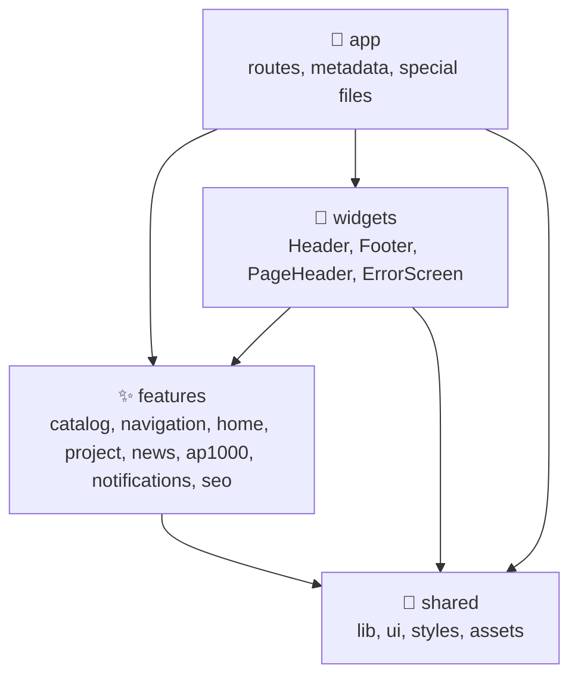
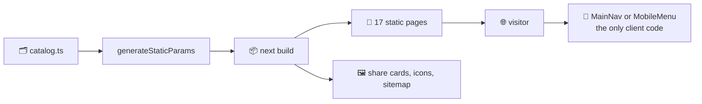

# 🏗️ Architecture

Core Web is a Next.js 16 App Router site. Every page is prerendered at build time from the texts in the repository, so a visit costs a static file and a little JavaScript for the menu.

## 🧱 Layers



| Layer         | Holds                                                                       | May import               |
| ------------- | --------------------------------------------------------------------------- | ------------------------ |
| 🧭 `app`      | Routes, layouts, metadata, icons, the sitemap, robots and route handlers    | everything below         |
| 🧩 `widgets`  | Regions of the page that combine several features                           | `features`, `shared`     |
| ✨ `features` | One subject each: its data in `model/` and its components in `ui/`          | other features, `shared` |
| 🧰 `shared`   | Code that knows nothing about nuclear energy: the logo, icons, tokens, time | only `shared`            |

Oxlint enforces the directions with `no-restricted-imports` in `.oxlintrc.json`.

### ✨ Features

| Feature            | `model/`                                                                                  | `ui/`                                                                                      |
| ------------------ | ----------------------------------------------------------------------------------------- | ------------------------------------------------------------------------------------------ |
| 🗂️ `catalog`       | `SECTIONS`, `PAGES`, the placeholder text, addresses, numbering, counts and reading order | `SectionCard`, `TopicCard`, `TopicLinks`, `TopicPager`, `OtherSections`                    |
| 🧭 `navigation`    | `MENU` built from the catalog, `isWithin`, `currentGroup`, `trail`                        | `MainNav`, `MobileMenu`, `Breadcrumbs`                                                     |
| 🏠 `home`          | The texts of the home page and the fuel assembly lattice with its rings                   | `Hero`, `FuelAssembly`, `Overview`, `About`                                                |
| 👥 `project`       | The parts of the project page and the contacts                                            | `ProjectDetails`                                                                           |
| 📰 `news`          | `NEWS` and their order                                                                    | `NewsList`, `NewsBanner`                                                                   |
| ⚛️ `ap1000`        | The AP-1000 course: its modules, drawings, sources, scenarios, history, videos and quiz   | `Course`, `CourseNav`, `Article`, `Figure`, `PlantDiagram`, `Quiz` and the parts they show |
| 📴 `notifications` | The self-contained offline page and its policy                                            | `OfflineNotice`, `ServiceWorker`                                                           |
| 🔎 `seo`           | Page metadata and JSON-LD; `og/` draws share cards and app icons                          | `JsonLd`                                                                                   |

## 🖥️ Rendering



- 📄 **Static pages.** `[section]` and `[section]/[topic]` set `dynamicParams = false` and list their addresses with `generateStaticParams`, so an unknown slug is a `404` without any rendering.
- 🧭 **Little client code.** Only the menus, the offline notice, the service worker registration and the parts of the AP-1000 course a reader works with (the list of modules, the drawings that open full size, the pickers of positions and scenarios and the quiz) are client components; everything else renders on the server at build time. The pickers get their texts already rendered on the server and only switch which one is shown.
- ⚛️ **React Compiler** memoizes the client components; there is no manual `useMemo` or `useCallback`.
- 🔤 **Fonts** are served by the site itself. Unbounded comes from static files in `src/shared/assets/fonts` through `next/font/local`, split into a Cyrillic and a Latin part that are both preloaded; Montserrat and Martian Mono come from `next/font/google`, downloaded at build time. About 80 KB of fonts reach a page.
- 🔀 **Page changes** go through React's `<ViewTransition>` in the root layout: Next.js navigations are transitions, so the browser cross-fades the content while the header and footer stay put. `data-scroll-behavior="smooth"` on `<html>` lets Next.js jump to the top of a new page instead of scrolling smoothly up to it.

## 🗺️ Routes

| File                                     | Address                               | Kind                             |
| ---------------------------------------- | ------------------------------------- | -------------------------------- |
| `app/page.tsx`                           | `/`                                   | Static                           |
| `app/[section]/page.tsx`                 | `/osnovy`, `/reaktory`, …             | Static, one per section          |
| `app/[section]/[topic]/page.tsx`         | `/reaktory/vver-1000`, …              | Static, one per topic            |
| `app/pro-proiekt/page.tsx`               | `/pro-proiekt`                        | Static                           |
| `app/novyny/page.tsx`                    | `/novyny`                             | Static                           |
| `app/not-found.tsx`                      | any unknown address                   | `404`                            |
| `app/error.tsx` · `app/global-error.tsx` | a page or the layout that fails       | Client                           |
| `app/**/opengraph-image.tsx`             | `…/opengraph-image`                   | PNG, see [SEO](./seo.md)         |
| `app/icon.svg` · `app/favicon.ico`       | `/icon.svg`, `/favicon.ico`           | Static files                     |
| `app/apple-icon.tsx` · `app/pwa/[file]`  | `/apple-icon`, `/pwa/icon-192.png`, … | PNG                              |
| `app/manifest.ts`                        | `/manifest.webmanifest`               | Static                           |
| `app/sitemap.ts` · `app/robots.ts`       | `/sitemap.xml`, `/robots.txt`         | Static                           |
| `app/offline/route.ts`                   | `/offline`                            | Static HTML with its own policy  |
| `app/healthz/route.ts`                   | `/healthz`                            | `ok`, for Docker and the monitor |
| `app/.well-known/security.txt/route.ts`  | `/.well-known/security.txt`           | Dynamic, valid for a year        |

## 🗂️ The catalog

`features/catalog/model/catalog.ts` is the single source of the structure:

```ts
export const SECTIONS: readonly Section[] = [
  {
    slug: "reaktory",
    title: "Реактори",
    description: "Будова, принцип роботи та особливості основних типів реакторів.",
    topics: [{ slug: "vver-1000", title: "ВВЕР-1000", summary: "Водо-водяний енергетичний реактор" }],
  },
];
```

| Reads the catalog          | What it takes                                                                 |
| -------------------------- | ----------------------------------------------------------------------------- |
| 🧭 `navigation/model/menu` | Every section with its topics, then the two pages                             |
| 🗂️ `home/ui/Overview`      | The four sections with their topics                                           |
| 📂 `app/[section]`         | The section pages, their topic cards and the other sections                   |
| 📄 `app/[section]/[topic]` | The topic pages, their text, the other topics and the topics before and after |
| 🦶 `widgets/Footer`        | The four sections, then the two pages                                         |
| 🗺️ `app/sitemap.ts`        | Every address                                                                 |
| 🖼️ share cards             | The names and descriptions                                                    |

A new topic in the catalog therefore appears in the menu, the cards, the footer, the sitemap and the share cards in one change. How to write one is in [Content](./content.md).

## 🔗 Addresses in code

Links take a `Path` (`` `/${string}` ``) from `shared/lib/path.ts`, which typed routes accept for static and dynamic routes alike. Build addresses with `sectionHref()` and `topicHref()` rather than by hand, so a renamed slug cannot leave a broken link behind; the end-to-end suite also requests every link of every page.

## 🎨 Styles

SCSS modules beside every component, tokens in `shared/styles/_tokens.scss` and mixins in `_mixins.scss`. The design system is described in [Design](./design.md).
