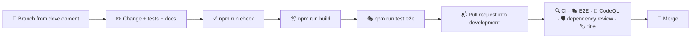

# 🤝 Contributing

## 🔄 Workflow



1. 🌿 Create a branch from `development`, named after the change: `feat/topic-pager`, `fix/menu-focus`.
2. ✅ Make your changes, add tests and run `npm run check` (and `npm run build` when routes, server code or configuration changed). For changes a visitor can see, also run `npm run test:e2e`.
3. 📝 Describe a user-visible change in one line under **Unreleased** in `CHANGELOG.md`.
4. 📬 Open a pull request into `development` and fill in the checklist from the template.
5. 🔀 Merge once everything is green. `development` reaches `staging` and `main` through the release flow in [Releases](./releases.md).

> [!TIP]
> `make setup` turns on the Git hooks in `.githooks/` (or run `git config core.hooksPath .githooks`). Before every commit they check the formatting and lint the staged files and look for em and en dashes; the message hook rejects messages that do not follow [Conventional Commits](#-commit-messages).

Bugs and ideas go through the issue forms in `.github/ISSUE_TEMPLATE`; security problems are reported privately as described in the [security policy](../.github/SECURITY.md).

> [!IMPORTANT]
> Keep `docs/` in sync with the code: a change to behaviour, a route, an environment variable or a script belongs in the same pull request as its documentation.

## 🧹 Code style

Formatting and linting are automated, so reviews can focus on behaviour.

- 🎨 **Oxfmt** formats TypeScript, SCSS, JSON, YAML and Markdown with a print width of 120 and sorts imports into groups. Run `npm run format`.
- 🧹 **Oxlint** enables the `correctness`, `suspicious` and `perf` categories with type-aware TypeScript rules, React hooks and React Compiler rules, the Next.js, `jsx-a11y`, `import`, `unicorn` and `vitest` plugins, plus the layer rules below. Run `npm run lint`.
- 🔷 **TypeScript** runs in strict mode with `noUncheckedIndexedAccess`, `verbatimModuleSyntax` and `erasableSyntaxOnly`.
- 🧾 **No em or en dashes** in code, docs or texts: `npm run lint:text`, part of `npm run check` and CI, points to each one. Use a comma, a colon or a hyphen instead.
- 🔗 **Shared files stay identical.** The Git hooks, the shared scripts in `scripts/`, the comment plugin and the editor and Dependabot settings are the same as in tasks, weather, faceit-stats and finance; `make shared` compares them when those apps are checked out next to this one, `make shared-sync` copies the files of this site over them, and the weekly **Shared files** workflow checks out the four repositories and runs the same comparison.

### 💬 Comments

Names, small functions and types carry the intent, and every function, component, hook and effect, and every block that is not obvious, gets one short line above it that says what it does:

```ts
// Drops later entries that describe an item already in the list
const unique = <Item>(items: readonly Item[], isSame: (a: Item, b: Item) => boolean) =>
```

> [!IMPORTANT]
> A custom Oxlint plugin in `lint/comments.js` (`local/short-comments`) reports comments longer than one line or 80 characters, comments at the end of a line of code and every lint, type or coverage directive (`eslint-disable`, `@ts-expect-error`, `istanbul ignore` and the like). Its second rule, `local/require-comments`, reports every function declaration and every variable holding a function without a comment line right above it.

Styles, configuration, Dockerfiles and workflows follow the same convention: mixins, keyframes, media and container queries and theme blocks carry a line too. Lists such as `.gitignore`, `.dockerignore` and the Oxlint overrides are split into groups, each with a one-line heading, and `tsconfig.json` groups its options the same way. Test helpers get a line like any other function. Anything that needs more than a line belongs in `docs/`.

### 🧭 Where code goes

| You are adding…                                      | Put it in                                         |
| ---------------------------------------------------- | ------------------------------------------------- |
| A page, a route handler or a special file            | `src/app/`                                        |
| A section, a topic or a text of the site             | the model files listed in [Content](./content.md) |
| Metadata, canonical links or structured data         | `src/features/seo/`                               |
| A region of the page that combines several features  | `src/widgets/<Widget>/`                           |
| Data or logic of one subject                         | `src/features/<feature>/model/`                   |
| A component that belongs to one feature              | `src/features/<feature>/ui/<Component>/`          |
| A helper or component that knows nothing about atoms | `src/shared/lib`, `src/shared/ui`                 |
| Design tokens and mixins                             | `src/shared/styles/`                              |

Imports only point downwards: `app → widgets → features → shared`. Oxlint reports any other direction.

> [!WARNING]
> Build the addresses of sections and topics with `sectionHref()` and `topicHref()`, never by hand: a renamed slug then moves every link with it.

### 📐 Conventions

| Topic               | Convention                                                                                                                                         |
| ------------------- | -------------------------------------------------------------------------------------------------------------------------------------------------- |
| 🧩 Components       | One folder per component: `Name/Name.tsx` and `Name.module.scss`, arrow functions, default export                                                  |
| 🖥️ Server or client | Server components by default; add `"use client"` only for state, effects, events or browser APIs                                                   |
| 🔒 Server code      | Anything that reads files, such as the share card fonts, imports `server-only`                                                                     |
| 🇺🇦 Texts            | Ukrainian, in the model files of their feature; see the writing rules in [Content](./content.md#-writing-rules)                                    |
| 🎨 Styles           | Tokens from `_tokens.scss`, the `container`, `blueprint`, `eyebrow`, `display`, `button`, `hover` and `visually-hidden` mixins, logical properties |
| 🛡️ CSP              | No `style` props and no scripts of other sites; draw with SVG attributes and classes                                                               |
| 🏷️ State attributes | Use `data-*` or ARIA attributes (`data-accent`, `aria-expanded`, `aria-current`) for visual states                                                 |
| 🎞️ Motion           | Animate `opacity` and `transform` only, and switch every animation off for `prefers-reduced-motion`                                                |
| 📥 Imports          | The `@/` alias for anything outside the current feature, relative paths inside it                                                                  |
| 🧪 Tests            | Next to the code as `*.test.ts(x)`; query by role and accessible name; type every mock                                                             |

## 📸 README pictures

`scripts/screenshots.mjs` takes every picture in `docs/images` from a running production build, with reduced motion so nothing is caught halfway through an animation:

```bash
make build
make start                                    # in another terminal
make screenshots                              # node scripts/screenshots.mjs http://localhost:3000
```

## 📝 Commit messages

Commits follow [Conventional Commits](https://www.conventionalcommits.org/):

```text
feat(menu): open the section of the current page
fix(menu): return the focus to the button after Escape
style: soften the hover of section cards
ci: verify npm registry signatures
docs: describe where the placeholders live
chore(deps): update next to 16.4
```

| Type          | Use it for                                      |
| ------------- | ----------------------------------------------- |
| ✨ `feat`     | A new feature                                   |
| 🐛 `fix`      | A bug fix                                       |
| ♻️ `refactor` | Code changes without new behaviour              |
| 💄 `style`    | Visual and styling changes                      |
| ✅ `test`     | Adding or updating tests                        |
| 📝 `docs`     | Documentation                                   |
| 👷 `ci`       | Pipeline and automation                         |
| ⚡ `perf`     | A faster or lighter app without new behaviour   |
| 📦 `build`    | The build, Docker images and build dependencies |
| 🔧 `chore`    | Dependencies and maintenance                    |
| ⏪ `revert`   | Reverting an earlier commit                     |

The `commit-msg` hook checks every message, and `.github/workflows/pr-title.yml` checks the title of every pull request, because a squash merge turns the title into the commit message.
